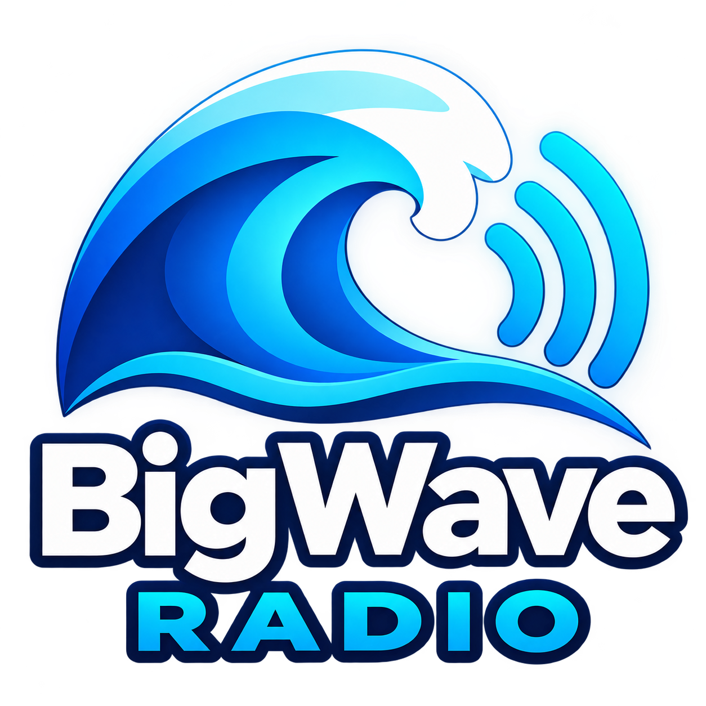
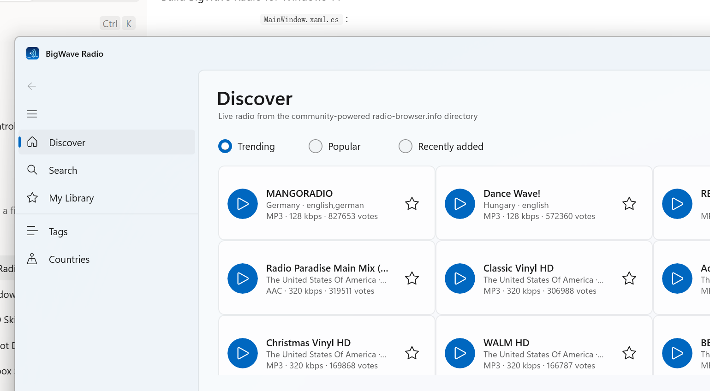

<p align="center">
  
</p>

<h1 align="center">BigWave Radio</h1>

<p align="center">
  A <strong>Windows 11 native</strong> internet radio player, powered by the community-run
  <a href="https://www.radio-browser.info/">radio-browser.info</a> station directory.
</p>



## What it does

- **Discover** — trending, most popular and recently added stations, one tap away
- **Search** — full-text search across the entire community directory, plus a
  floating **tag word cloud** shaped like a cloud: hover a word to glitch it,
  click it to search; faint musical notation drifts up behind it
- **Browse** — by tag or by country, with live station counts
- **My Library** — star any station for quick reference; saved locally on your PC
  (`%LocalAppData%\BigWaveRadio\library.json`). Stations are always **streamed live**,
  never downloaded
- **Bitrate filter** — show only streams at or above 64 / 128 / 192 / 256 / 320 kbps,
  straight from the side menu; applies to every list and is remembered between sessions
- **Station info panel** — the playing station's logo, tags, votes and homepage link
  in a panel on the right (toggle in the title bar)
- **Live status** — the bar shows Connecting… while the stream opens, Connected once playing
- **Themes** — light / dark / match-system, with nine accent colours
  (Settings page); station cards hover-highlight in your accent
- **Now playing bar** — play/pause/stop, volume, **sleep timer** (15/30/60 min),
  one-tap save-to-library
- **Community friendly** — load is spread across radio-browser mirrors and every
  play reports a click back to the directory

## Download

Grab [`BigWaveRadio-Setup-0.2.exe`](https://github.com/postmanpat-303/BigWaveRadio/releases/download/v0.2/BigWaveRadio-Setup-0.2.exe)
from the [v0.2 release](https://github.com/postmanpat-303/BigWaveRadio/releases/tag/v0.2)
and run it. The wizard installs to Program Files with a Start Menu entry and a
proper uninstaller (one UAC prompt). Self-contained — no .NET runtime needed.
Requires Windows 10 19041+ (x64) or Windows 11.

## Windows 11 native

- Mica backdrop, rounded corners and an in-app title bar with the app icon
- Station grid **reflows automatically** as you resize — from full screen down to
  a narrow column; the navigation pane collapses on small windows
- Scales cleanly across monitors and DPI settings

## Tech

| Layer | Choice |
|---|---|
| UI | WinUI 3 (Windows App SDK 1.8), unpackaged, self-contained |
| Framework | .NET 8, `net8.0-windows10.0.19041.0` |
| MVVM | CommunityToolkit.Mvvm |
| Directory | radio-browser.info public JSON API (mirror-rotating client) |
| Playback | `Windows.Media.Playback.MediaPlayer` |

```
src/
  BigWaveRadio.Core/   radio-browser API client, models, library service
  BigWaveRadio.App/    WinUI 3 app (pages, view models, controls, assets)
docs/
  screenshot.png       app on Windows 11
```

The app icon and title-bar logo are generated from the master logo in
`src/BigWaveRadio.App/Assets/bigwave-logo-src.png` — regenerate with
`python make_icon.py` after updating it.

## Build & run

```powershell
dotnet restore
dotnet build
dotnet run --project src/BigWaveRadio.App
```

Or open `BigWaveRadio.slnx` in Visual Studio 2022 (Windows App SDK workload) and press F5.

The app is unpackaged (no MSIX installer) and the Windows App SDK runtime is
self-contained, so the output folder can be zipped and copied to any Windows 10
1809+ / Windows 11 machine as-is.

## Build the setup package

With [Inno Setup 6.3+](https://jrsoftware.org/isdl.php) installed:

```powershell
dotnet build src\BigWaveRadio.App\BigWaveRadio.App.csproj -p:Platform=x64 -c Release -r win-x64 --self-contained
robocopy src\BigWaveRadio.App\bin\x64\Release\net8.0-windows10.0.19041.0\win-x64 installer\staging /E /XD publish
& "C:\Program Files (x86)\Inno Setup 6\ISCC.exe" installer\BigWaveRadio.iss
```

Output: `dist\BigWaveRadio-Setup-0.1.exe`.

## Notes

- Station streams are served directly by each broadcaster; availability and
  quality depend on them.
- radio-browser.info is a volunteer-run, user-contributed directory — the client
  rotates mirrors and sends a proper user agent to be a good citizen.

## Roadmap ideas

- Station logos / favicons in cards
- Recently played history
- Global media-key (play/pause) support
- Taskbar jump-list of favorite stations
- GitHub Actions CI build
